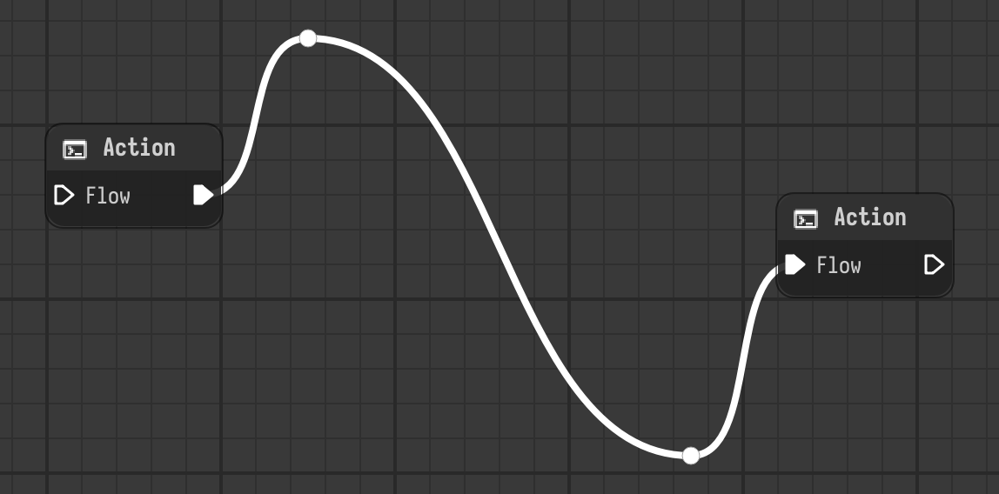

# Link pins

Pins are points a link is drawn through. They are part of the model, saved with the link,
and every change to them is a command, so they follow the same rules as the rest of the
stage. This page describes the pieces, for people working on Nyx or on tools that read and
write stages.



## Model

`Link.pins` (in `nyx.core.link`) is a list of `QtCore.QPointF` in graph coordinates, from
the source of the link to its target. The property returns copies, so changing the list
doesn't change the link. Setting it replaces the pins and emits
`Stage.link_pins_changed(link_uuid)`.

```python
from PySide6 import QtCore
from nyx.api.v1 import commands

link = stage.get_object(link_uuid)
stage.push_command(
    commands.SetLinkPinsCommand(stage, link, [QtCore.QPointF(300.0, -80.0)])
)
```

Always change pins with `SetLinkPinsCommand`, not by setting `Link.pins`, unless you are
restoring state inside another command. The command stores the old pins for undo. It
replaces the whole list, so adding, moving and removing a pin are the same command with a
different list. Its `target_nodes` are the two nodes the link connects, so it is refused
for links inside a referenced stage. It doesn't set `MODIFIES_STRUCTURE`.

A command that removes and recreates links has to carry the pins itself, because recreating
a link only gives it its ends and uuid. `UnlinkNodeComponentsCommand` does: it reads the
pins in `redo` and sets them again in `undo`. Do the same in a new command of that kind.
Commands that go through serialization, like deleting a node, get them for free.

## File format

`Link.serialize` writes the pins under a `pins` key as a list of `[x, y]`, after
`source_uuid` and `target_uuid`:

```json
{
  "source_uuid": "...",
  "target_uuid": "...",
  "pins": [[100.0, 80.0], [300.0, -80.0]]
}
```

The key is left out for a link without pins, so files without pins are unchanged.
`Link.deserialize` reads it with an empty default, so older files load.

## Editor

| Piece | Where | Role |
| --- | --- | --- |
| `build_link_path` | `editor/graphics/link_path.py` | Takes the pins too. It builds each part between two points with the path builder of the style and joins them. |
| `find_pin_index` | `editor/graphics/link_path.py` | Finds where a new pin goes: the part of the link that passes closest to a point. |
| `GraphicsLinkPin` | `editor/graphics/graphics_link_pin.py` | The dot. A movable child of `GraphicsLink`. It redraws the link while it moves and asks the link to push the move when the mouse is released. |
| `GraphicsLink` | `editor/graphics/graphics_link.py` | Owns the pin items. `add_pin`, `remove_pin` and `commit_pins` push `SetLinkPinsCommand`, `set_pins` only shows pins, `pin_color` is the color of the pins. |
| `GraphicsStage.find_link_at` | `editor/graphics/graphics_stage.py` | Finds the link near a scene position, with a tolerance, so a thin link can be double-clicked. |
| `StageGraphView.mouseDoubleClickEvent` | `editor/views/stage_graph_view.py` | Adds a pin on a double-clicked link. A double-clicked pin removes itself. |

Things that are easy to get wrong:

- **The scene is rebuilt after every command.** `GraphicsStage.rebuild_current_scope` runs on
  every change of the undo stack, so the `GraphicsLink` and its pins are new items after a
  command. Don't keep a reference to a link or pin item across a push, and don't touch an
  item after the command that deletes it (`GraphicsLinkPin` clears its state before
  committing for this reason).
- **Dragging doesn't push.** A pin only moves the item while it is dragged and the move is
  pushed once, on release, so one drag is one undo step.
- **Don't take the pin color from the pen.** A link between plugs of different colors is
  stroked with a gradient, and the color of a gradient pen is black. Use
  `GraphicsLink.pin_color`.
- **Graphics objects passed to `create_graphics_object` for a link** get `pins=` as a keyword
  argument next to `link_uuid`. A replacement for `GraphicsLink` registered under
  `core.link` (see [graphics objects](plugins/graphics-object.md)) has to accept it, which
  is easiest by subclassing `GraphicsLink`.

## Tests and images

The tests are in `tests/editor/test_link_pins.py`: path building, serialization, the
command with undo, deserialization from a file, and the mouse interactions on a real view.

The images on this page and in the [user guide](../user/link-pins.md) are rendered, not
screenshots. Regenerate them after changing how links or pins are drawn:

```sh
uv run python scripts/docs_images.py links    # docs/_static/images/link-pins/
```
