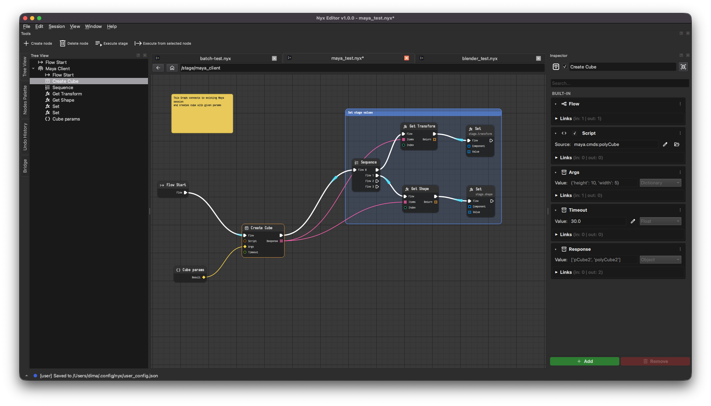

# Nyx

Nyx is a nodal execution graph written in Python. You build a **stage** out of nodes
whose components are connected by links, and run it in a PySide6 editor or headless from
the command line. Plugins add nodes, components and datatypes. A TCP **bridge** lets a
stage run code in other applications such as Maya and Blender.



## Guides

<div class="grid cards" markdown>

- **[User Guide](user/index.md)**

    How a graph executes, datatypes, referencing other stages, remote nodes, batch mode and
    the configuration file.

- **[Developer Guide](dev/index.md)**

    How the registry works, profiling, and how to write plugins: nodes, function nodes,
    components, QML editors, datatypes, util objects and graphics objects.

</div>

## Quick start

```sh
git clone https://github.com/sowwic/nyx.git
cd nyx
uv sync --locked --dev
uv run nyx                                   # open the editor
uv run nyx stage run path/to/stage.nyx       # run a stage headless
```

See the [README](https://github.com/sowwic/nyx#readme) for installation as a package, the
standalone build, plugins and the bridge.
