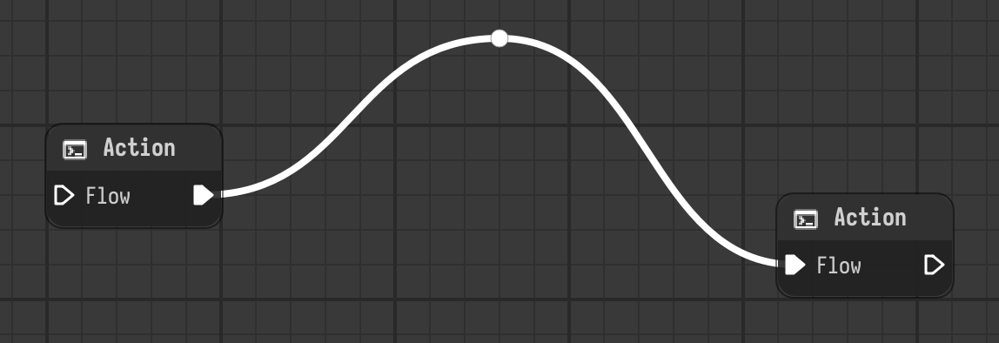
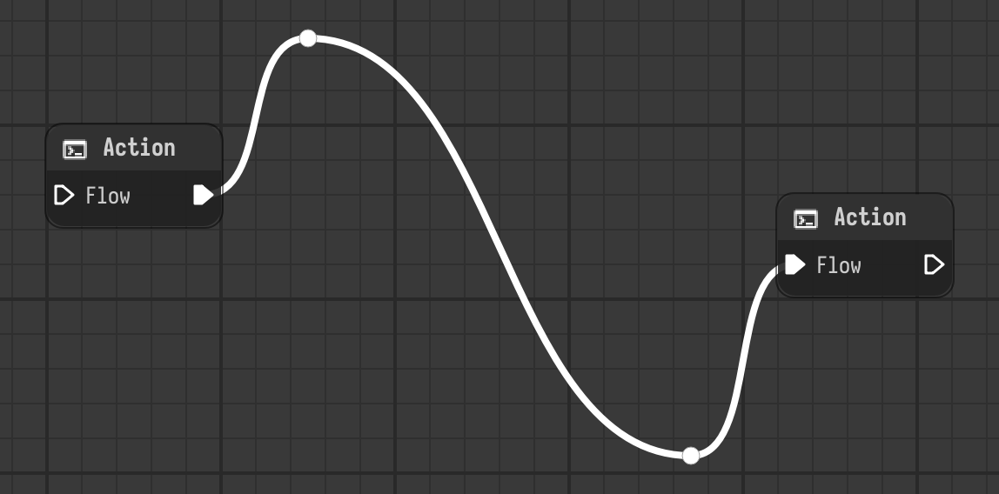

# Link pins

A link is drawn from the output plug of one component to the input plug of another. When
a graph grows, links run across nodes or bend in ways that are hard to follow. A **pin** is
a small dot you put on a link: the link is drawn through it, so you decide where it goes.

Pins only change how a link is drawn. They have no effect on execution, on the values the
link carries, or on which components are connected.

## Using pins

| To | Do |
| --- | --- |
| Add a pin | Double-click the link. The pin appears under the cursor. |
| Move a pin | Drag it. The link follows while you drag. |
| Remove a pin | Double-click the pin. |

A link can have as many pins as you need. A new pin goes into the part of the link that
passes closest to where you clicked, so the link goes through the pins in the order they
are along it, from the source to the target.

Things to know:

- A pin belongs to one link. Links don't share pins, and deleting a link deletes its pins.
- Pins are free: they don't snap to the grid and aren't attached to a node. Moving a node
  doesn't move the pins of its links.
- A pin has the color of the plug the link comes from. For a link between plugs of
  different colors, that is the color of the source end.
- Every change is a step in the undo history, adding, moving and removing a pin each.
  Undoing the removal of a link, or of the node it connects, brings its pins back.
- Pins can't be changed on links of a [referenced stage](referencing.md), like any other
  part of it.

## Pins and the link style

The pins stay the same whichever style the links are drawn in. Each part of the link, from
the source to the first pin, between pins, and from the last pin to the target, is drawn in
the configured `graphics_stage.link_style` (`bezier`, `direct` or `square`), see
[Customization](customization.md).

## Saved with the stage

Pins are saved in the `.nyx` file, inside the link they belong to. Stages saved before pins
existed open as before, and a link without pins doesn't write anything extra.
