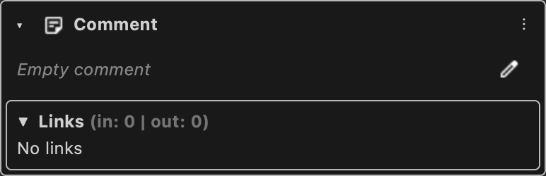

# Comment

Static text for notes. Does not take part in execution.

Type id: `core:comment`

## How it works

- Static, editable text, starts expanded. Its datatype is string.
- It takes no part in execution.
