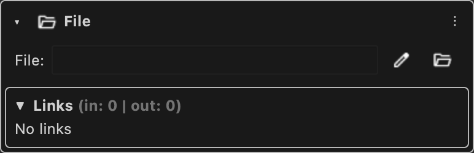

# File

Holds the path of a file, typed or picked with a file dialog.

Type id: `core:file`

## How it works

- Static and editable. The path is kept as a string.
- Type the path or pick it with a file dialog.

## Used by

- [Reference](../nodes/reference.md)
