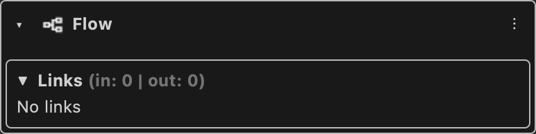

# Flow

Connects the execution flow from one node to the next.

Type id: `core:flow`

## How it works

- White pentagon plug. It links only to other flow components, and a data component can never be linked to it.
- Carries no data: it says which node runs next. Links of the flow are drawn twice as thick as the others.
- A flow component has a single output link. A node can be active or inactive; nodes that make a decision, like [Branch](../nodes/branch.md), switch some of their flow outputs off.
- See [How a graph executes](../../execution.md).

## Used by

- [Set](../nodes/set.md)
- [Action](../nodes/action.md)
- [Branch](../nodes/branch.md)
- [For Loop](../nodes/for-loop.md)
- [For Each Loop](../nodes/for-each-loop.md)
- [While Loop](../nodes/while-loop.md)
- [Flow Start](../nodes/flow-start.md)
- [Sequence](../nodes/sequence.md)
- [Log](../nodes/log.md)
- [Type Cast](../nodes/type-cast.md)
- [Get Type](../nodes/get-type.md)
- [Remote Client](../nodes/remote-client.md)
- [Remote Action](../nodes/remote-action.md)
- [Launch Process](../nodes/launch-process.md)
