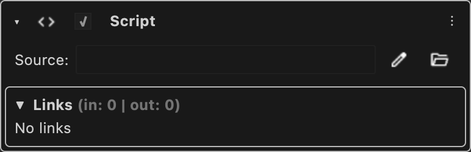

# Remote Script

Names a python file or a module entry point to run in an external process, instead of in the application.

Type id: `core:remote_script`

## How it works

- Like [Script](script.md), but it does nothing in the application: the script runs in the external process of the [Remote Client](../nodes/remote-client.md) the node is inside of.
- See [Remote nodes and the bridge](../../remote-nodes.md).

## Used by

- [Remote Action](../nodes/remote-action.md)
