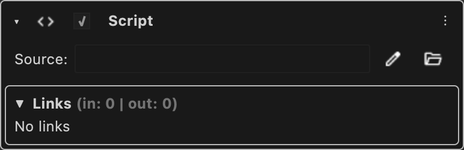

# Script

Runs a python file or a module entry point when the node executes.

Type id: `core:script`

## How it works

- Runs when the node executes.
- The value is either the path of a Python file, or a `module:function` entry point. It is literal: the path is never evaluated as an expression.
- Editable, starts expanded.
