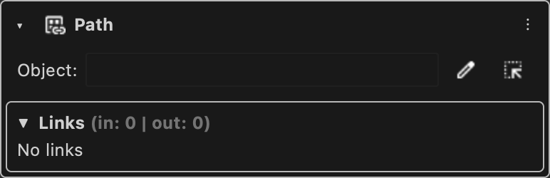

# Object Path

Holds the path of a node or component in the stage and resolves it to the object.

Type id: `core:stage_object_path`

## How it works

- Holds a path like `/stage/node.component`. Absolute paths and paths relative to the scope of the owner both work.
- Resolves the path to the node or component it points at. It is empty until the path points at something that exists.
- Has a datatype of its own, which also accepts a string.

## Used by

- [Set](../nodes/set.md)
- [Get](../nodes/get.md)
