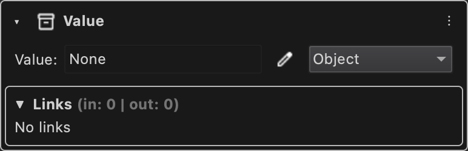

# Value

Holds a typed value that can be edited, linked to other components or pulled by them.

Type id: `core:value`

## How it works

- Static and editable: you can type the value, link another component into it, or have other components pull it.
- Pick its datatype with the datatype selector, see [Datatypes](../../datatypes.md). Without one it is shown with the datatype of the value it holds.
- Most inputs and outputs of the built-in nodes are value components.

## Used by

- [Set](../nodes/set.md)
- [Get](../nodes/get.md)
- [Value](../nodes/value.md)
- [Branch](../nodes/branch.md)
- [Dict](../nodes/dictionary.md)
- [List](../nodes/list.md)
- [For Loop](../nodes/for-loop.md)
- [For Each Loop](../nodes/for-each-loop.md)
- [While Loop](../nodes/while-loop.md)
- [Log](../nodes/log.md)
- [Type Cast](../nodes/type-cast.md)
- [Get Type](../nodes/get-type.md)
- [Remote Client](../nodes/remote-client.md)
- [Remote Action](../nodes/remote-action.md)
- [Launch Process](../nodes/launch-process.md)
