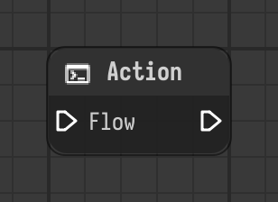

# Action

Runs its components when the flow reaches it. A general purpose step with a flow input and output.

Type id: `core:action`

## Components

| Name | Plug | Datatype | Description |
| --- | --- | --- | --- |
| `flow` | in / out | Flow | Connects the execution flow from one node to the next. |

## How it works

- A general purpose step: the flow comes in, the node runs its components, the flow continues.
- It has no other components. Add some to give it behavior, for example a [Script](../components/script.md).
