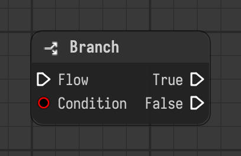

# Branch

Continues through the true or false flow output depending on the condition value.

Type id: `core:branch`

## Components

| Name | Plug | Datatype | Description |
| --- | --- | --- | --- |
| `flow` | in | Flow | Execution flow into the node. |
| `true` | out | Flow | Flow that continues when the condition is true. |
| `false` | out | Flow | Flow that continues when the condition is false. |
| `condition` | in | Boolean | Value that chooses the output. Anything that isn't false, zero or empty counts as true. |

## How it works

- The decision is made after the node is evaluated: only the chosen output is active, the nodes behind the other one don't run.
- `condition` is read as a boolean. Anything that isn't false, zero or empty counts as true.
- It has a flow input only. The outputs are `true` and `false`.
