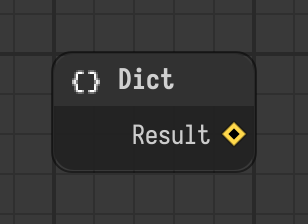

# Dict

Collects value components and creates a dictionary result.

Type id: `core:dictionary`

## Components

| Name | Plug | Datatype | Description |
| --- | --- | --- | --- |
| `result` | out | Dictionary | Result dictionary |

## How it works

- Collects the value components of the node itself, keyed by the display name of each component.
- Add [Value](../components/value.md) components to it for the entries.
- Add an [Object Path](../components/stage-object-path.md) component to point it at other nodes. Their value components are collected too.
