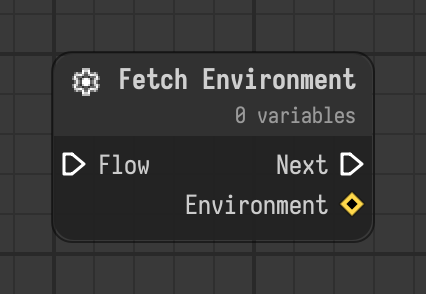

# Fetch Environment

Reads the environment variables of the application into a dictionary when the flow reaches it.

Type id: `core:fetch_environment`

## Components

| Name | Plug | Datatype | Description |
| --- | --- | --- | --- |
| `flow` | in | Flow | Execution flow into the node. |
| `next` | out | Flow | Flow that continues once the environment is read. |
| `environment` | out | Dict | Environment variables, name to value, as they were when the node ran. |

## How it works

- Runs when the flow reaches it and stores a copy of the environment in `environment`.
  The value is a snapshot: to see a change made later, like one by a set environment
  function node, run the node again. Before the first run it is empty.
- Select the node to see the variables in the Inspector as a list.
- The dictionary is a copy. Changing it does not change the environment.
- Link `environment` to the `env` input of a [Launch Process](launch-process.md) node
  to start a process with the environment of Nyx plus your changes.
