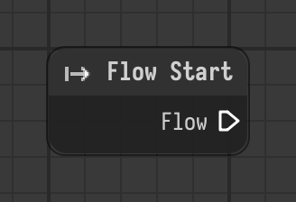

# Flow Start

Marks where the execution flow of the parent scope begins.

Type id: `core:flow_start`

## Components

| Name | Plug | Datatype | Description |
| --- | --- | --- | --- |
| `flow` | out | Flow | Connects the execution flow from one node to the next. |

## How it works

- Has a single flow output and no input. The crawler looks for it in a scope and begins the execution there.
- A scope without a Flow Start runs none of its children.
