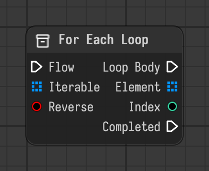

# For Each Loop

Runs the loop body for every element of an iterable, optionally in reverse, then continues with completed.

Type id: `core:for_each_loop`

## Components

| Name | Plug | Datatype | Description |
| --- | --- | --- | --- |
| `flow` | in | Flow | Execution flow into the node. |
| `iterable` | in | Object | Collection to go through, like a list or a string. |
| `reverse` | in | Boolean | Go through the elements from the last to the first. |
| `loop_body` | out | Flow | Flow that runs once for every element. |
| `element` | out | Object | Element of the current run of the loop body. |
| `index` | out | Integer | Position of the current element. |
| `completed` | out | Flow | Flow that continues after the last run of the loop body. |

## How it works

- The chain linked to `loop_body` runs once for every element, then the flow continues through `completed`.
- `iterable` can be a list, a string or anything else you can go through.
- `element` and `index` are outputs. Link them to the nodes inside the body.
