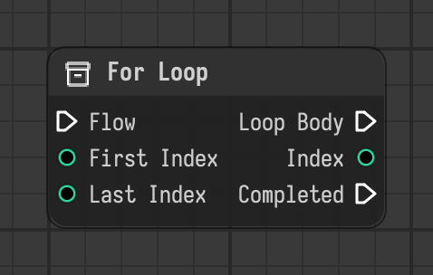

# For Loop

Runs the loop body for every index from the first to the last index, then continues with completed.

Type id: `core:for_loop`

## Components

| Name | Plug | Datatype | Description |
| --- | --- | --- | --- |
| `flow` | in | Flow | Execution flow into the node. |
| `first_index` | in | Integer | Index the loop starts with. |
| `last_index` | in | Integer | Index the loop ends with, this one included. |
| `loop_body` | out | Flow | Flow that runs once for every index. |
| `index` | out | Integer | Index of the current run of the loop body. |
| `completed` | out | Flow | Flow that continues after the last run of the loop body. |

## How it works

- The chain linked to `loop_body` runs once for every index, then the flow continues through `completed`.
- `last_index` is included: from 0 to 2 the body runs three times.
- `index` is an output. Link it to the nodes inside the body.
