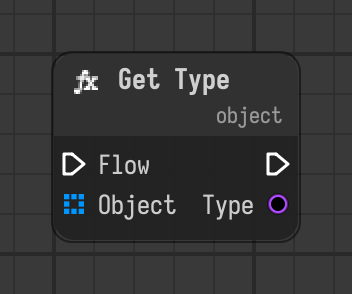

# Get Type

Finds the type of an object when the flow reaches it.

Type id: `core:get_type`

## Components

| Name | Plug | Datatype | Description |
| --- | --- | --- | --- |
| `flow` | in / out | Flow | Connects the execution flow from one node to the next. |
| `object` | in | Object | Object to get the type of. |
| `type` | out | Type | Class of the object. |

## How it works

- Finds the type when the flow reaches the node, and the flow continues.
- The `type` output can be linked to the `type` of a [Type Cast](type-cast.md).
