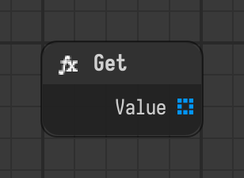

# Get

Provides the value of a component of another node.

Type id: `core:get`

## Components

| Name | Plug | Datatype | Description |
| --- | --- | --- | --- |
| `component` | out | Object Path | Path of the component to read, like /stage/node.component. |
| `value` | out | Object | Value of the component the path points at. |

## How it works

- Has no flow component. It reads the component the path points at when something pulls its value.
- `component` is a path like `/stage/node.component`, absolute or relative to the scope of the node.
