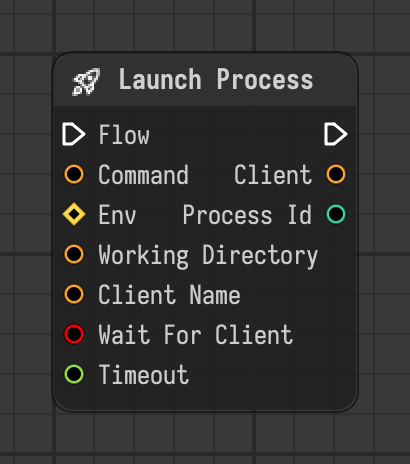

# Launch Process

Starts a process that connects to the bridge server, like a headless application, waits for it and stops it when the nodes inside are done.

Type id: `core:launch_process`

## Components

| Name | Plug | Datatype | Description |
| --- | --- | --- | --- |
| `flow` | in / out | Flow | Connects the execution flow from one node to the next. |
| `command` | in | String | Command line to run. $NAME and ${NAME} are replaced by environment variables, the ones of `env` included. |
| `env` | in | Dictionary | Environment variables added to the ones of the application. |
| `working_directory` | in | String | Folder to run the command in. Empty uses the current one. |
| `client_name` | in | String | Name the process is to connect to the bridge as. Empty makes one up. |
| `wait_for_client` | in | Boolean | Wait until the process has connected before the nodes inside run. |
| `timeout` | in | Float | Seconds to wait for the process to connect before failing. 0 or less waits forever. |
| `client` | out | String | Name the process connects as. |
| `process_id` | out | Integer | Id of the process. |

## How it works

- Acts as a scope: starts the process, runs the nodes inside of it, and stops the process when they are done.
- In `command`, `$NAME` and `${NAME}` are replaced by environment variables, the ones of `env` included.
- With `wait_for_client` on, the nodes inside run only after the process has connected to the bridge as `client_name`.
- Details: [Remote nodes and the bridge](../../remote-nodes.md).
