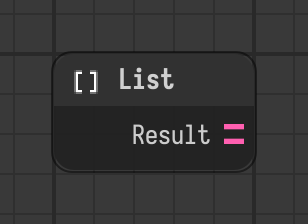

# List

Collects value components and creates a list result.

Type id: `core:list`

## Components

| Name | Plug | Datatype | Description |
| --- | --- | --- | --- |
| `result` | out | List | Result list |

## How it works

- Collects the value components of the node itself, in the order of the components.
- Add [Value](../components/value.md) components to it for the elements.
- Add an [Object Path](../components/stage-object-path.md) component to point it at other nodes. Their value components are collected too, and come first.
