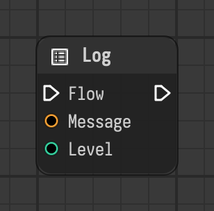

# Log

Writes a message to the log with the chosen level.

Type id: `core:log`

## Components

| Name | Plug | Datatype | Description |
| --- | --- | --- | --- |
| `flow` | in / out | Flow | Connects the execution flow from one node to the next. |
| `message` | in | String | Text to write to the log. |
| `level` | in | Integer | Importance of the message as a logging level: 10 debug, 20 info, 30 warning, 40 error, 50 critical. |

## How it works

- Writes the message to the log when the flow reaches the node, and the flow continues.
- `level` is a Python logging level:

| Level | Name |
| --- | --- |
| 10 | debug |
| 20 | info |
| 30 | warning |
| 40 | error |
| 50 | critical |

