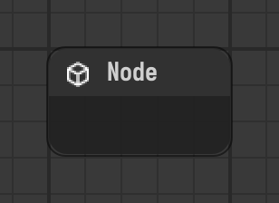

# Node

Empty node without components. Groups other nodes inside of it.

Type id: `core:node`

## How it works

- Has no components of its own. Its job is to be a **scope**: nodes created inside it are its children.
- A node that contains children runs them with itself, after the node by default, starting from the [Flow Start](flow-start.md) of its scope.
