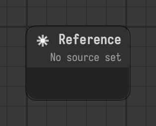

# Reference

Stands for a stage file, with the components of its top node.

Type id: `core:reference`

## Components

| Name | Plug | Datatype | Description |
| --- | --- | --- | --- |
| `source` | out | String | Stage file to reference, absolute or relative to the file of this stage. |

## How it works

- Stands for another stage file. The components of the top node of that stage are shown on the node.
- `source` is absolute or relative to the file of the stage that holds the reference.
- What you can change, how it is saved and reloaded: see [Referencing stages](../../referencing.md).
