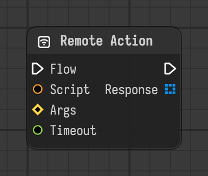

# Remote Action

Runs code in the external process of the Remote Client it is inside of and outputs the value the code assigned to `result`.

Type id: `core:remote_action`

## Components

| Name | Plug | Datatype | Description |
| --- | --- | --- | --- |
| `flow` | in / out | Flow | Connects the execution flow from one node to the next. |
| `script` | in | String | Python file or module:function entry point to run in the client. Assign the value to send back to `result`. |
| `args` | in | Dictionary | Variables the script can use, by name. |
| `timeout` | in | Float | Seconds to wait for the answer before failing. 0 or less waits forever. |
| `response` | out | Object | Value the script assigned to `result`. |

## How it works

- Has to be inside of a [Remote Client](remote-client.md). The script runs in the process of that client.
- `script` is a Python file or a `module:function` entry point. Assign the value to send back to `result`: it comes out in `response`.
- `args` are variables the script can use, by name.
- Details: [Remote nodes and the bridge](../../remote-nodes.md).
