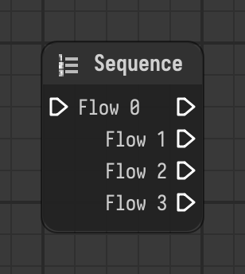

# Sequence

Continues through all of its flow outputs one after another, in order.

Type id: `core:sequence`

## Components

| Name | Plug | Datatype | Description |
| --- | --- | --- | --- |
| `flow_0` | in / out | Flow | Execution flow into the node. |
| `flow_1` | out | Flow | Flow that continues as step 1. |
| `flow_2` | out | Flow | Flow that continues as step 2. |
| `flow_3` | out | Flow | Flow that continues as step 3. |

## How it works

- Has one flow input, `flow_0`, and the outputs `flow_1` to `flow_3`.
- All outputs are active at once. Each one is followed completely, depth first, before the next one starts.
