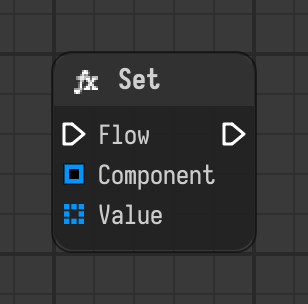

# Set

Sets the value of a component of another node when the flow reaches it.

Type id: `core:set`

## Components

| Name | Plug | Datatype | Description |
| --- | --- | --- | --- |
| `flow` | in / out | Flow | Connects the execution flow from one node to the next. |
| `component` | in | Object Path | Path of the component to change, like /stage/node.component. |
| `value` | in | Object | Value to set. |

## How it works

- `component` is the path of the component to change, like `/stage/node.component`. It is absolute, or relative to the scope of the node.
- The value is written when the flow reaches the node, and the flow continues.
