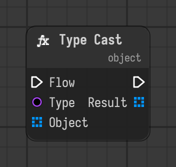

# Type Cast

Converts an object to the given type when the flow reaches it, e.g. a string to an int.

Type id: `core:type_cast`

## Components

| Name | Plug | Datatype | Description |
| --- | --- | --- | --- |
| `flow` | in / out | Flow | Connects the execution flow from one node to the next. |
| `type` | in | Type | Class to convert the object to. |
| `object` | in | Object | Object to convert. |
| `result` | out | Object | The object converted to the type. |

## How it works

- Converts when the flow reaches the node, and the flow continues.
- `type` is the class to convert to, for example `int` for a string with digits.
