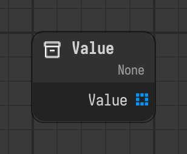

# Value

Provides a value that can be edited and linked to other nodes.

Type id: `core:value`

## Components

| Name | Plug | Datatype | Description |
| --- | --- | --- | --- |
| `value` | out | Object | Value of the node, it can be edited or linked. |

## How it works

- Has no flow component. It runs when something pulls its value.
- Edit the value on the node or link another component into it. Its datatype is `Object` until you pick another one, see [Datatypes](../../datatypes.md).
- Use it to share one value between several nodes.
