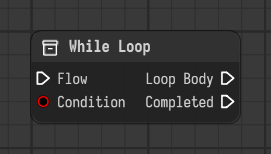

# While Loop

Runs the loop body for as long as the condition is true, then continues with completed.

Type id: `core:while_loop`

## Components

| Name | Plug | Datatype | Description |
| --- | --- | --- | --- |
| `flow` | in | Flow | Execution flow into the node. |
| `condition` | in | Boolean | The loop body keeps running as long as this is true. |
| `loop_body` | out | Flow | Flow that runs while the condition is true. |
| `completed` | out | Flow | Flow that continues once the condition is false. |

## How it works

- The chain linked to `loop_body` runs again and again while `condition` is true, then the flow continues through `completed`.
- Something inside the body has to change the condition, for example with a [Set](set.md), otherwise the loop never ends.
