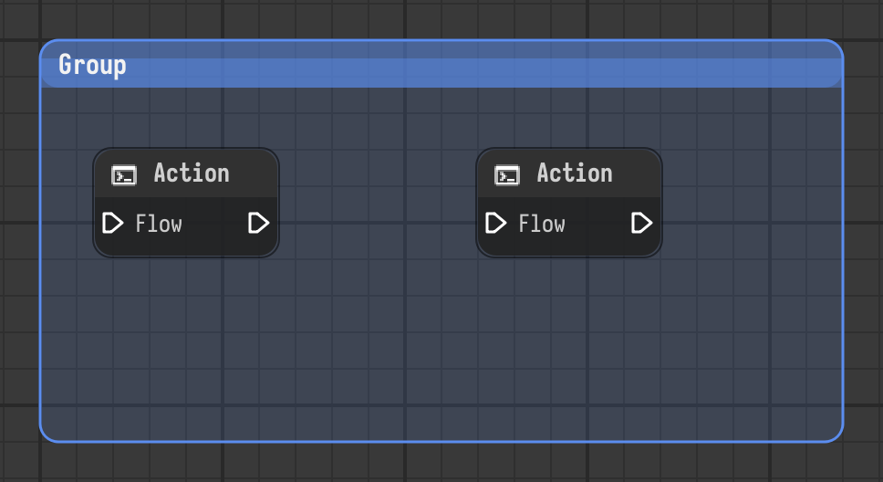

# Group

Titled frame around nodes. Moving it moves the nodes inside.

Type id: `core:group`

## How it works

- A titled frame behind the nodes it surrounds, to keep them together. Moving the group moves the nodes inside.
- It doesn't execute. Create it with the **Create group** action (`Ctrl+G`).
