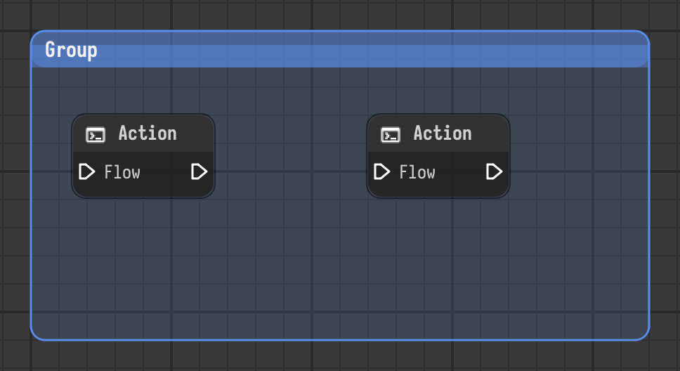

# Group

Titled frame around nodes. Moving it moves the nodes inside.

Type id: `core:group`

## How it works

- A titled frame behind the nodes it surrounds, to keep them together. Moving the group moves the nodes inside.
- It doesn't execute. Create it with the **Create group** action (`Ctrl+G`), or from the **Create** menu of the graph.
- Groups stack by size: a group inside another is always above it, so you can click, move and resize it whichever group was made first. Groups of the same size stack in the order they were created.
- To reach something a click can't, such as two groups of the same size on top of each other, right-click it and choose from the **Select** menu. It lists everything stacked under the cursor, the topmost first.
